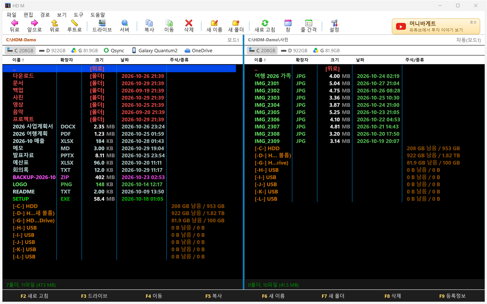
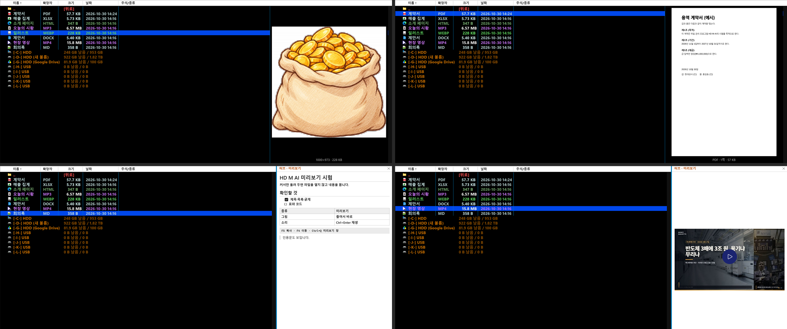
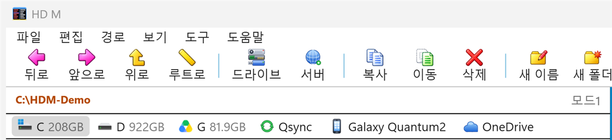
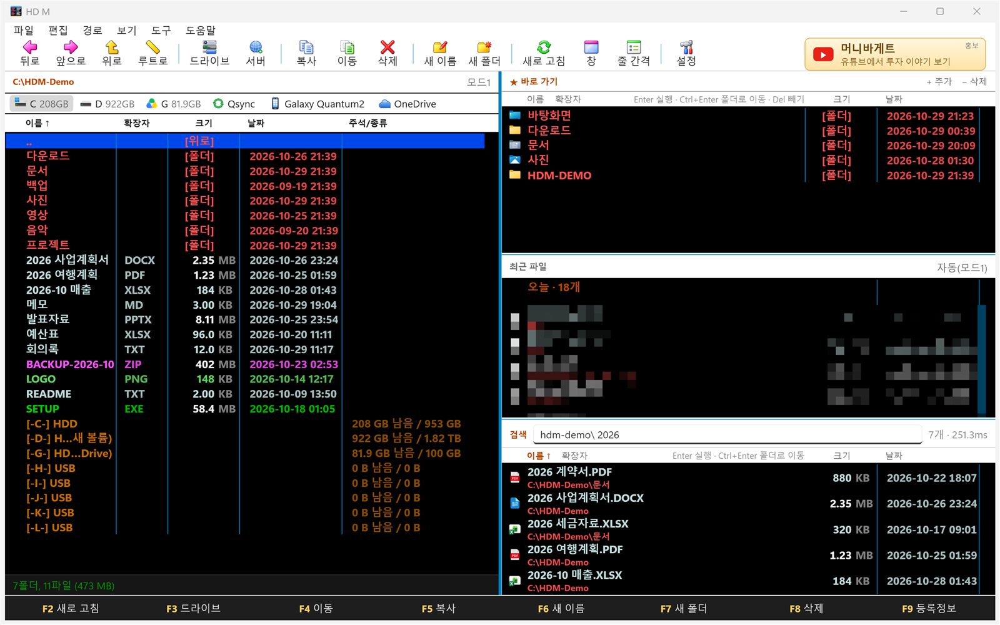
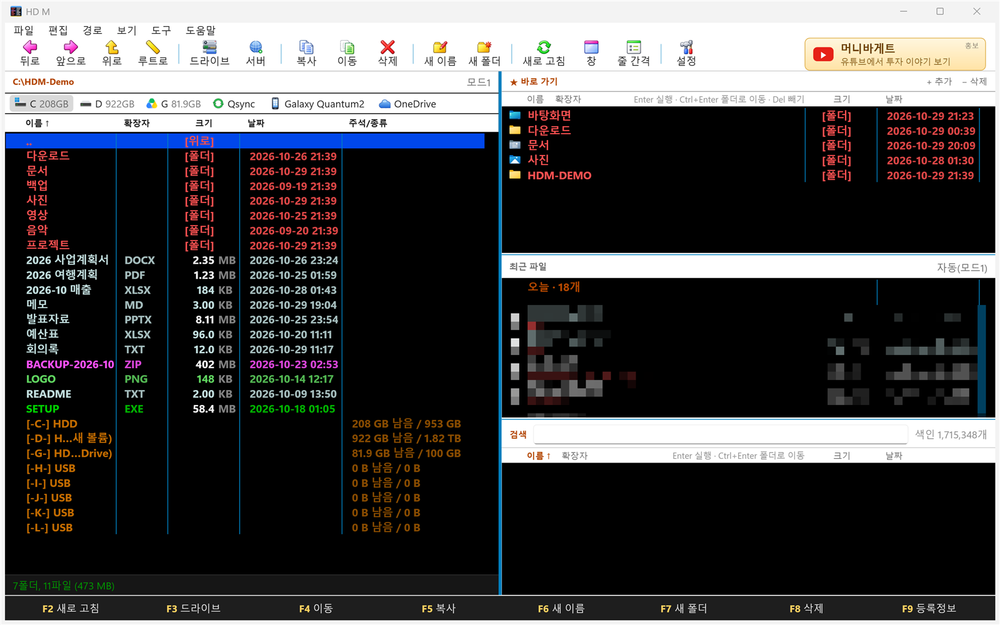
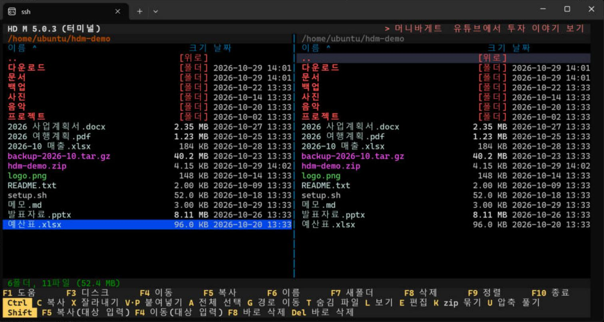

# HD M AI

**Mdir과 WinM을 쓰던 분들을 위해, 2026년 윈도우에 맞춰 다시 만든 M입니다.**

Mdir For Windows 4.5.591 Beta를 참고하여 2026년에 맞게 재작성한 프로그램입니다.
창 두 개를 나란히 놓고 키보드로 파일을 휙휙 옮기던 그 손맛은 그대로 두고, 요즘 쓰는 것들을 얹었습니다.
휴대폰과 NAS가 드라이브처럼 보이고, FTP·SFTP 서버가 내 디스크처럼 열리고, 수십만 개 파일 속에서도 글자 몇 개로 바로 찾아집니다.

> **HD M AI는 프리웨어입니다.** 개인이든 회사든 무료로 쓰실 수 있습니다.
>
> **받기:** [Releases](../../releases/latest)에서 `HDM-5.1-setup.exe`를 받아 설치하면 끝입니다. 닷넷 같은 걸 따로 깔 필요가 없습니다.



*화면의 파일 이름과 폴더는 설명용 예시입니다.*

---

## 옛날 M을 쓰던 분은 이렇게 쓰시면 됩니다
손가락에 예전 단축키를 기억할 겁니다.
작업이 간편하고 빨라집니다.

- **키는 그대로입니다.** Tab으로 창 바꾸고, F5 복사, F4 이동, F6 이름 바꾸기, F7 새 폴더, F8 삭제, F10 MCD, `Shift+영문`으로 드라이브 이동. 손이 기억하는 대로 누르세요.
- **환경설정도 그대로입니다.** 여섯 탭(파일창·표시·처리·색깔·프로그램·기타)에 옵션이 끝도 없이 있습니다. 색 하나, 줄 간격 하나까지 내 입맛대로 맞춥니다.
- **옛 설정을 가져옵니다.** 쓰던 WinM의 `.CFG`와 `.col` 색 테마를 환경설정 › 기타에서 불러올 수 있습니다.
- **모르는 기능은 `Ctrl+P`.** 명령 이름이나 초성(`ㅂㄱㅅ`)만 치면 모든 기능이 나옵니다. 단축키를 몰라도 됩니다.

## 👀 열지 않고 봅니다 — 미리보기

**파일을 열어 보는 시간이 업무에서 사라집니다.**
목록에서 커서만 올려 두면 그 파일이 바로 옆에 보입니다. 더블클릭하고, 프로그램이 뜨길 기다리고, 아니면 닫고, 다음 파일을 다시 여는 일이 없습니다. 방향키로 훑기만 하면 됩니다.



*위: 목록 옆 미리보기(그림·PDF). 아래: 허브의 미리보기 칸(마크다운·동영상). 미리보기는 한 번에 하나만 켜집니다 — 기본은 허브 칸이고, 목록 옆으로 바꾸면 허브 칸은 저절로 꺼집니다. 화면의 파일은 설명용 예시입니다.*

| 종류 | 보이는 것 |
|---|---|
| 그림 (jpg·png·gif·webp·bmp…) | 보일 크기로 줄여서 바로, 가로×세로와 용량 |
| PDF | 첫 쪽 그대로 (PDF 프로그램이 없어도 윈도우에 든 것으로 그립니다) |
| 워드·엑셀·파워포인트·한글(hwpx) | 문서에 든 썸네일이나 앞부분 글. `Ctrl+Enter`면 문서 화면으로 |
| 마크다운 | 제목·목록·표·굵게까지 모양을 살려서 |
| 글·코드·로그·CSV·JSON | 앞부분 글 |
| 웹페이지 | 제목과 본문 글만 — 브라우저를 띄우지 않아 소리도 스크립트도 없습니다 |
| 동영상·소리 | 장면·앨범 그림. **`Ctrl+Enter`(또는 미리보기를 누르면) 그 자리에서 재생**, 갑자기 소리가 나지 않게 저절로 틀지 않습니다 |

- **목록 옆 빈자리**에 보입니다. 여유가 있으면 주석/종류 글은 그대로 두고 그 오른쪽에, 모자라면 그 자리에 놓입니다. 이름·확장자·크기·날짜는 가리지 않습니다.
- 더 크게 보려면 **미리보기 창(`Ctrl+Q`)** — 파일창과 허브 사이에 붙습니다.
- 방향키로 훑는 동안은 읽지 않고, 커서가 멈춘 뒤에만 읽습니다. 수만 개짜리 폴더에서도 목록이 느려지지 않습니다. OneDrive에만 있는 파일은 내려받기가 시작되지 않게 건너뜁니다.
- 압축 파일은 미리보기 대신 예전처럼 **Enter로 안에 들어가** 봅니다.
- 보기 › 「미리보기 (파일 목록 옆)」으로 켜고 끕니다.

## 🤖 AI가 파일을 정리합니다

- **AI 파일 정리** (툴바 「AI」, `Ctrl+Shift+I`): 「사진은 찍은 해별로」처럼 적으면 AI가 새 폴더·옮기기·이름 바꾸기 계획을 냅니다. 줄마다 확인한 것만 실행하고, 지우는 일은 없으며, `Ctrl+Z`로 되돌립니다.
- **AI 연결** (도구 › AI 연결): Claude·OpenAI·xAI API 키를 넣거나, **Claude·ChatGPT 구독 계정으로 로그인**해서 씁니다. 모델은 목록에서 고르고(Claude haiku·sonnet·opus·fable, OpenAI luna·terra·sol·astra, xAI grok), 쓸 때마다 그 계열의 가장 새 모델이 쓰입니다.
- **작업 기록**: AI가 일하는 동안 창 아래 흰 칸에 지금 하는 일이 실시간으로 나옵니다.
- Claude Code·Codex 같은 AI가 HD M AI를 직접 다루게 할 수도 있습니다(함께 들어 있는 `hdm-ai.exe`, MCP 서버). 폴더 이동·찾기·미리 읽기에 더해 복사·이동·삭제(휴지통)까지 하고, 모두 `Ctrl+Z`로 되돌립니다.

## 이번에 새로 넣은 것들

### 📱 휴대폰, OneDrive, NAS가 드라이브 막대에 뜹니다
탐색기 왼쪽 목록에 보이는 것은 M의 드라이브 막대에도 보입니다.
윈도우에 연결된 휴대폰, OneDrive, Qsync·Dropbox 같은 동기화 폴더, 네트워크의 NAS가 각자의 아이콘으로 나옵니다. 누르면 그 안으로 들어갑니다. 휴대폰 사진 폴더도 그냥 폴더처럼 열립니다.
(휴대폰은 윈도우 「휴대폰 연결」로 이어진 것이 열립니다. USB 케이블로만 연결한 휴대폰은 탐색기로 열립니다.)



### 🌐 FTP·FTPS·SFTP 서버를 드라이브처럼
`Ctrl+Shift+N`으로 서버를 등록하면 드라이브 막대에 단추가 생깁니다. 누르면 접속하고, 서버 폴더가 파일창에 그대로 열립니다.
반대쪽 창에 내 PC 폴더를 열어 두고 F5·F4를 누르면 올리고 내려받습니다. 복사 중에도 다른 폴더로 돌아다닐 수 있습니다.
비밀번호는 이 PC의 내 윈도우 계정으로만 풀리게 암호화해서 저장하고, SFTP는 처음 보는 서버의 지문을 확인해 줍니다.

### 🔍 파일 이름 검색이 즉시 나옵니다 (Everything 방식)
`Ctrl+J`로 허브 창을 열면 아래 칸에 검색창이 있습니다. 디스크 전체의 파일 이름을 미리 색인해 두어서 한 글자 칠 때마다 결과가 바뀝니다.
- 초성 검색 `ㅂㄱㅅ`, 와일드카드 `*` `?`
- 조건 붙이기: `size:>100mb`, `dm:이번주`, `dm:7d`(최근 7일), `ext:pdf;docx`, `folder:`, `!제외할낱말`
- 정렬 머리글을 누르면 보이는 것만이 아니라 **맞는 전체**가 그 순서로 다시 정렬됩니다.



### 🧭 허브 — 오른쪽에 세 칸이 붙습니다


파일창 배치(단일·좌우·위아래)와 따로, 맨 오른쪽에 허브 칸이 붙습니다. 보기 › 창 › 「허브 창」으로 켜고 끕니다(기본은 켬).
- **★ 바로 가기**: 바탕화면·다운로드·문서 같은 기본 폴더, 방금 일하던 폴더, 자주 가는 폴더가 저절로 채워집니다. `+ 추가`, `− 삭제`로 내 것도 넣을 수 있습니다.
- **최근 파일**: 탐색기의 「최근 항목」처럼 내가 연 파일을 오늘·어제·이번 주로 묶어 보여 줍니다.
- **검색**: 위에서 말한 즉시 검색입니다.

칸 제목을 끌어서 순서를 바꾸면 다음 실행에도 남습니다.

### ⚡ 폴더 이동이 빠릅니다
Enter를 누르면 바로 들어갑니다. 파일 수만 개짜리 폴더도 화면에 보이는 줄만 그려서 방향키를 누르고 떼는 대로 따라옵니다.
이전 M에서 답답했던 부분을 다시 짰습니다.

### ↩️ `Ctrl+Z` 되돌리기
복사·이동·이름 바꾸기·새 폴더를 되돌립니다. 잘못 옮겼을 때 한 번이면 됩니다.

### 🪄 복사하면서 다른 일을 하세요
복사·이동·삭제는 뒤에서 돌고, 상태줄에 진행 막대와 속도가 나옵니다. 그동안 다른 폴더를 돌아다니거나 다른 작업을 해도 됩니다. Esc로 중단합니다.

### 🎨 깃과 클라우드 상태를 목록에서 바로
- 깃 저장소 안에서는 고친 파일에 「깃 수정」·「깃 새 파일」·「깃 충돌!」이, 폴더에는 「깃 3개 변경」이 색으로 붙습니다.
- OneDrive 폴더에서는 「☁ 클라우드」(내 PC에 없음)와 「● 항상 유지」가 붙습니다.

### 🗂 그 밖의 것들
| 키 | 하는 일 |
|---|---|
| `Ctrl+T` / `Ctrl+W` | 탭 열기 / 닫기 |
| `Ctrl+Q` | 미리보기 창 (파일창 옆에 크게) |
| `Ctrl+Shift+B` | 양쪽 폴더 비교 (다른 것, 한쪽에만 있는 것을 선택해 줍니다) |
| `Ctrl+Shift+U` | 중복 파일 찾기 |
| `Ctrl+Alt+S` / `Ctrl+Alt+C` | 큰 파일 쪼개기 / 합치기 (1.4MB 플로피 크기부터, CRC 검사 포함) |
| 경로 줄 클릭 | 주소를 직접 입력해서 바로 이동 (`%환경변수%`, 따옴표 경로, 파일 경로도 됩니다) |
| `Ctrl+Shift+Z` | 속성·날짜 한꺼번에 바꾸기 |
| 일괄 이름 바꾸기 | 선택한 파일들의 이름을 규칙대로 바꿉니다 |
| 휴지통 관리 | 휴지통을 열어 골라서 복원하거나 영구 삭제합니다 |

zip·tar·tar.gz는 바로 풀고 묶습니다. 7z·rar는 7-Zip이 깔려 있으면 풀 수 있습니다.

---

## 🐧 리눅스 터미널판 (처음 내놓는 버전)

리눅스 서버에서 SSH로 붙어서도 쓸 수 있는 터미널 안의 두 창 파일 관리자입니다. 윈도우 판과 같은 색상표와 단축키 감각으로 만들었습니다.



*오라클 클라우드 Ubuntu 서버에서 Windows 터미널로 접속해 띄운 화면입니다.*

```
tar xzf hdm-tui-5.0.3-linux-x64.tar.gz
cd hdm-tui-5.0.3-linux-x64
./hdm
```

- **F5·F4**는 묻지 않고 반대쪽 창 폴더로 바로 복사·이동합니다. **Ctrl+C·Ctrl+X·Ctrl+V**(또는 Ctrl+P)로 복사·잘라내기·붙여넣기도 됩니다.
- 한글 이름 줄이 칸에 맞게 나오고, 초성(`ㅂㄱㅅ`)으로 빨리찾기를 할 수 있습니다. 삭제는 리눅스 표준 휴지통(`~/.local/share/Trash`)으로 갑니다.
- 화면 아래에 F키·Ctrl·Shift 단축키가 항상 보입니다. 자세한 키는 묶음 안의 `사용법.md`에 있습니다.
- x86_64 리눅스용 단일 파일이라 따로 깔 것이 없습니다. **오라클 클라우드 Ubuntu 24.04**에서 확인했고, 다른 배포판과 터미널은 아직 확인하지 못했습니다.
- 서버 연결(FTP·SFTP), 허브, 즉시 검색, 그림 미리보기는 터미널판에 아직 없습니다.
- [5.0.3 릴리스](../../releases/tag/v5.0.3)에서 `hdm-tui-5.0.3-linux-x64.tar.gz`를 받으세요.

---

## 설치하기

1. [Releases](../../releases/latest)에서 `HDM-5.1-setup.exe`를 받아 실행합니다. 내 계정에만 설치되고 관리자 권한은 필요 없습니다. 5.0을 쓰던 분도 그대로 덮어 설치하면 설정이 남습니다.
2. 설치 없이 쓰려면 `HDM-5.1.zip`을 풀어서 `HDM.exe`를 실행하세요. 폴더째 옮겨 다니며 쓸 수 있습니다.
3. 처음 실행할 때 윈도우 SmartScreen이 「알 수 없는 게시자」라고 막을 수 있습니다. 서명하지 않은 프로그램이라 그렇습니다. **추가 정보 → 실행**을 누르세요.

윈도우 10·11 64비트에서 동작합니다. 설정은 설치 폴더의 `settings.json`에 저장되고, 새 버전을 설치해도 덮어쓰지 않습니다.
처음 열면 만든 쪽이 맞춰 둔 기본 화면(검정 목록, 촘촘한 줄 간격, 아이콘 없는 목록)이 나옵니다. 환경설정(`Ctrl+F12`)에서 마음대로 바꾸세요.

## 알아두세요

- 프리웨어라서 무료로 쓰고 주변에 나눠 주셔도 됩니다. 다만 소스는 공개하지 않습니다. 이 저장소는 내려받는 곳입니다.
- 서버 간 직접 복사, 서버 폴더의 크기 계산, 서버로의 끌어 놓기는 아직 안 됩니다.
- 쓰다가 이상한 점이 있으면 [Issues](../../issues)에 남겨 주세요. 설정 폴더(`%APPDATA%\WinMNext`)의 `error.log`를 같이 주시면 빠릅니다.

현대상사
